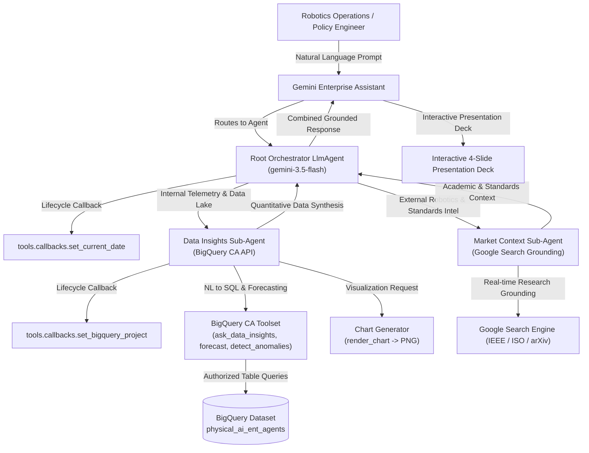

# Physical AI & Robotics Enterprise Agents Architecture

Comprehensive system topology, database registry, and multi-agent routing graph for **Physical AI Enterprise Agents** on Gemini Enterprise.

---

## 1. System Topology Overview

- **Total Domains:** 5
- **Total Deployed Agents:** 5
- **Total Knowledge Graph Nodes:** 46
- **Total Relational Edges:** 35
- **Primary BigQuery Dataset:** `physical_ai_ent_agents`

---

## 2. Multi-Agent Swarm Topology

---

## 3. Physical AI Domains & Agent Inventory

| Domain ID | Strategic Domain | Deployed Agent | BigQuery Table Prefix | Core Scope |
| :---: | :--- | :--- | :---: | :--- |
| `rdop` | **Robot Data Operations & Teleoperation** | `data_collection_annotation_ops` | `rdop_dcao_*` | Teleoperation hours, annotation stages, QA velocity |
| `pedi` | **Policy Evaluation & Failure Diagnostics** | `multimodal_eval_failure_diagnostics` | `pedi_mefd_*` | Multimodal rollout retrieval, grasp failure root causes, singularities |
| `s2rs` | **Sim-to-Real & Synthetic Data Pipeline** | `synthetic_scene_curation_copilot` | `s2rs_sscc_*` | Low-data regimes, 3D USD assets, domain randomization |
| `ftpm` | **Fleet Telemetry & Predictive Maintenance** | `fleet_diagnostics_hardware_maintenance` | `ftpm_fdhm_*` | Motor thermal spikes, harmonic backlash, force-torque SOPs |
| `scpr` | **Safety, Compliance & Policy Release** | `embodied_ai_safety_audit` | `scpr_easa_*` | Torque limit verification, ISO/TS 15066 safety gates, release readiness |

---

## 4. Graph Artifacts

- SQLite Graph Database: `graphify-out/graph.sqlite`
- JSON Graph Topology: `graphify-out/graph.json`
