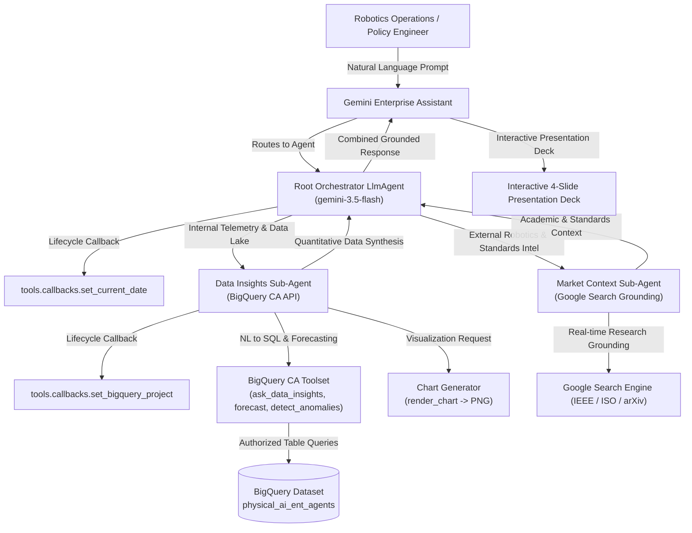

# Agent and solutions for Physical AI

Enterprise agents and cloud solutions for Physical AI, Robotics, and Embodied AI lifecycle.
Organized across 5 core product categories: **Agent Platform**, **Data**, **Model**, **AI Infra**, and **Gemini Enterprise**.
Each agent and solution answers operational, scientific, and engineering questions by querying BigQuery through Conversational Analytics, database backends, or multimodal models, supplemented by Google Search grounding for external robotics literature (arXiv, CoRL, ICRA), IEEE RAS standards, and ISO/OSHA safety specifications.

---

## What's Built

> 💡 **Tip**: Click on any section accordion below to collapse/expand its deployed solution roster, links, product tags, and KPI focus.

<details open>
<summary><b>🧩 Agent Platform, Data, Model & AI Infra Solutions (15 Catalog Entries)</b></summary>
<br/>

> **Source**: *Great Opportunities for South Korea in Physical AI* deck — "Google Cloud a key stack for Physical AI" pillars (Interaction, AI Agent & Apps, Auto Label, Data Curation, Training, Simulation, Synth Data Gen, Robotic Model / On-Device).

| No. | Product | Solution | Domain | Core Stack | Demo / Slides |
| :--- | :---: | :--- | :--- | :--- | :---: |
| 1 | `Agent Platform` | **Gemini Live Interaction** | 🗣️ Human-Robot Interaction | Gemini Live API, Vertex AI RAG Engine, Multimodal Embeddings, Agent Engine | [🎬 Unitree Live Demo](demos/agent-platform/gemini_live_interaction.mp4) / <a href="https://gemini-robotic-er2-242017771503.us-central1.run.app/?model=gemini-3.8-live" target="_blank" rel="noopener noreferrer">⚡ Live Demo</a> (15–17, 21) |
| 2 | `Model` | **Gemini Robotics ER Model** | 🤖 Robot Foundation Models & Edge | Gemini Robotics ER 2 / Gemini Robotics 2 | [🎬 Slide 81 Video](demos/model/gemini_robotics_er_model.mp4) / <a href="https://gemini-robotic-er2-242017771503.us-central1.run.app/?model=gemini-robotics-er-2-streaming-preview" target="_blank" rel="noopener noreferrer">⚡ Live Demo</a> (74–81) |
| 3 | `Agent Platform` | **Robotics Auto-Labeling** | 🏷️ Auto-Labeling & Data Curation | Gemini Flash, Batch Prediction, GCS, BigQuery | [🎬 Auto-Label + JSON Demo](demos/agent-platform/robotics_auto_labeling.mp4) (23, 24, 26) |
| 4 | `Agent Platform` | **Self-tuning Agent for Auto-Labeling** | 🏷️ Auto-Labeling & Data Curation | ADK, Gemini, Agent Platform Evaluation | [🖼️ Slides P25 / P26](demos/screenshots/slide_25.png) (25, 26) |
| 5 | `AI Infra` | **Real2Sim Reconstruction & 500Hz Dexterous Twin** | 🌐 Sim-to-Real & Synthetic | Gemini 4 Argon, MuJoCo / MJWarp, MuJoCo WASM, MediaPipe, Cloud Run | [🎬 4 Real2Sim Videos](demos/model/real2sim_human_view.mp4) / <a href="https://real2sim-242017771503.us-central1.run.app/" target="_blank" rel="noopener noreferrer">⚡ Live Demo</a> (Argon 6–9) |
| 6 | `Agent Platform` | **Robot Skills & Action Agent** | 🗣️ Human-Robot Interaction | ADK, Agent Engine, Connectors | [⚡ Case / Link](https://bostondynamics.com/blog/tools-for-your-to-do-list-with-spot-and-gemini-robotics/) (11, 16, 18, 79) |
| 7 | `Agent Platform` | **Multi-View VLA Validation Judge** | 🔬 Policy Evaluation | Gemini, Agent Engine | [🖼️ Slides P29 / P30](demos/screenshots/slide_29.png) (29–30) |
| 8 | `Agent Platform` | **Synthetic Data Factory (Veo / Nano Banana / Imagen)** | 🌐 Sim-to-Real & Synthetic | Agent Platform, Veo 3, Nano Banana 2, Imagen 4, Genie 3 | [🎬 Slide 36 Veo AMR Video](demos/agent-platform/synthetic_data_factory.mp4) / <a href="https://robotic-prompt-generator-811235746107.us-central1.run.app/" target="_blank" rel="noopener noreferrer">⚡ Live Demo</a> (32–39) |
| 9 | `Data` | **Multimodal Robot Data Vector Search** | 🏷️ Auto-Labeling & Data Curation | gemini-embedding-2, Vector Search | [🎬 VectorSearch Demo](demos/data/multimodal_robot_vector_search.mp4) (44–45) |
| 10 | `Data` | **Smart Storage Auto-Annotate + BigQuery Insights** | 🏷️ Auto-Labeling & Data Curation | GCS Auto Annotate, Storage Insights, BigQuery | [🖼️ Slide P51](demos/screenshots/slide_51.png) (51) |
| 11 | `Data` | **Robot Data Flywheel Platform** | ⚙️ Fleet Telemetry | Pub/Sub, Dataflow, BigQuery, Cloud Storage, Looker | [🎬 Demo Video](demos/data/robot_data_flywheel_platform.mp4) (43, 52, 101, 118) |
| 12 | `Data` | **GCP Smart Vision (Edge Video to Semantic Alerts)** | 🏷️ Auto-Labeling & Data Curation | Gemma/Tiny-Gemma, Gemini, Vector Search, Cloud Run | [🖼️ Slide P49 Screenshot](demos/screenshots/slide_49.png) (47–50) |
| 13 | `Model` | **Gemma 4 On-Device Multilingual Robot Brain** | 🤖 Robot Foundation Models & Edge | Gemma 4, Gemma 3n, GDC Edge, Coral | [🖼️ Slides P71 / P73](demos/screenshots/slide_71.png) / [⚡ Gemma 4](https://blog.google/innovation-and-ai/technology/developers-tools/gemma-4/) (71, 73) |
| 14 | `AI Infra` | **Scalable Physics Simulation (MuJoCo / Isaac Sim)** | 🌐 Sim-to-Real & Synthetic | MuJoCo MJX / MJWarp, NVIDIA Isaac Sim, G4 VMs, GKE, TPU | [🎬 Genie 3 Sim Demo](demos/ai-infra/scalable_physics_simulation.mp4) (55–58, 66, 112) |
| 15 | `AI Infra` | **Embodied AI & RL Model Training** | 🤖 Robot Foundation Models & Edge | AI Hypercomputer (GPU/TPU), Vertex AI Training, GKE + DWS, Isaac Lab RL | [🖼️ Slides P61 / P60](demos/screenshots/slide_61.png) (60–61, 66) |

</details>

<details open>
<summary><b>🦾 Robot Data Operations & Teleoperation (Gemini Enterprise)</b></summary>
<br/>

> **Domain Scope**: Robot data lake indexing, teleoperation demonstration capture, annotation pipeline throughput, QA verification velocity, and collection site quota tracking.

| No. | Product | Agent / Solution | Demo | Focus of Solution |
| :--- | :---: | :--- | :---: | :--- |
| 15 | `Gemini Enterprise` | [Data Collection & Annotation Ops Intelligence](domains/robot_data_ops/agents/data_collection_annotation_ops/README.md) | <a href="demos/gemini-enterprise/robot_data_ops/data_collection_annotation_ops.html" target="_blank" rel="noopener noreferrer">🎬 Demo</a> | Robotics data ops intelligence connecting Cloud Storage/BigQuery data lakes to monitor teleop hours, annotation stages, and QA verification velocity. |

</details>

<details open>
<summary><b>🔬 Policy Evaluation & Failure Diagnostics (Gemini Enterprise)</b></summary>
<br/>

> **Domain Scope**: Multimodal evaluation rollout retrieval, task success rate diagnostics, specular object grasping failure root-cause analysis, and kinematic joint singularity isolation.

| No. | Product | Agent / Solution | Demo | Focus of Solution |
| :--- | :---: | :--- | :---: | :--- |
| 16 | `Gemini Enterprise` | [Multimodal Evaluation & Failure Root Cause Analysis](domains/policy_eval_diagnostics/agents/multimodal_eval_failure_diagnostics/README.md) | <a href="demos/gemini-enterprise/policy_eval_diagnostics/multimodal_eval_failure_diagnostics.html" target="_blank" rel="noopener noreferrer">🎬 Demo</a> | Multimodal reasoning over evaluation rollout videos, metric tables, and run logs to diagnose edge-case failures and retrieve exact error segments. |

</details>

<details open>
<summary><b>🌐 Sim-to-Real & Synthetic Data Pipeline (Gemini Enterprise)</b></summary>
<br/>

> **Domain Scope**: Low-data regime identification (< 20 hrs), 3D OpenUSD asset library retrieval, and procedural domain randomization configuration (lighting, friction, clutter) for NVIDIA Isaac Sim.

| No. | Product | Agent / Solution | Demo | Focus of Solution |
| :--- | :---: | :--- | :---: | :--- |
| 17 | `Gemini Enterprise` | [Synthetic Scene & Edge-Case Curation Copilot](domains/sim_to_real_synthetic/agents/synthetic_scene_curation_copilot/README.md) | <a href="demos/gemini-enterprise/sim_to_real_synthetic/synthetic_scene_curation_copilot.html" target="_blank" rel="noopener noreferrer">🎬 Demo</a> | Bridges real-world failure logs with 3D simulation asset repositories to translate edge cases into domain randomization parameters for low-data regimes. |

</details>

<details open>
<summary><b>⚙️ Fleet Telemetry & Predictive Maintenance (Gemini Enterprise)</b></summary>
<br/>

> **Domain Scope**: High-frequency joint telemetry streams, motor thermal spike anomaly detection, harmonic drive backlash monitoring, and step-by-step 6-axis force-torque sensor recalibration SOPs.

| No. | Product | Agent / Solution | Demo | Focus of Solution |
| :--- | :---: | :--- | :---: | :--- |
| 18 | `Gemini Enterprise` | [Fleet Diagnostics & Hardware Maintenance Assistant](domains/fleet_telemetry_maintenance/agents/fleet_diagnostics_hardware_maintenance/README.md) | <a href="demos/gemini-enterprise/fleet_telemetry_maintenance/fleet_diagnostics_hardware_maintenance.html" target="_blank" rel="noopener noreferrer">🎬 Demo</a> | Grounds Gemini Enterprise on joint telemetry, error codes, and repair SOPs to troubleshoot anomalies and guide field hardware maintenance. |

</details>

<details open>
<summary><b>🛡️ Safety, Compliance & Policy Release (Gemini Enterprise)</b></summary>
<br/>

> **Domain Scope**: Pre-deployment safety benchmarks, dynamic torque limits, ISO 10218 / ISO/TS 15066 compliance verification, human-in-the-loop stress tests, and automated release gate checklists.

| No. | Product | Agent / Solution | Demo | Focus of Solution |
| :--- | :---: | :--- | :---: | :--- |
| 19 | `Gemini Enterprise` | [Embodied AI Safety Audit & Release Readiness Agent](domains/safety_compliance_release/agents/embodied_ai_safety_audit/README.md) | <a href="demos/gemini-enterprise/safety_compliance_release/embodied_ai_safety_audit.html" target="_blank" rel="noopener noreferrer">🎬 Demo</a> | Integrates benchmark evaluations and ISO/OSHA robotic safety standards to generate safety audit summaries before weights are flashed to edge hardware. |

</details>

---

## System Architecture



---

## 5 Physical AI Domains Matrix (5 Agents)

| Domain | Domain ID | Agents Count | Tables Count | Core Domain Scope |
| :--- | :---: | :---: | :---: | :--- |
| **Robot Data Operations & Teleoperation** | `rdop` | 1 | 3 | Teleoperation hours, annotation stages, QA velocity |
| **Policy Evaluation & Failure Diagnostics** | `pedi` | 1 | 3 | Multimodal rollout retrieval, grasp failure root causes, singularities |
| **Sim-to-Real & Synthetic Data Pipeline** | `s2rs` | 1 | 3 | Low-data regimes, 3D USD assets, domain randomization |
| **Fleet Telemetry & Predictive Maintenance** | `ftpm` | 1 | 3 | Motor thermal spikes, harmonic backlash, force-torque SOPs |
| **Safety, Compliance & Policy Release** | `scpr` | 1 | 3 | Torque limit verification, ISO/TS 15066 safety gates, release readiness |
| **TOTALS** | **5 Domains** | **5 Agents** | **15 Tables** | **Complete Physical AI & Embodied AI Lifecycle Coverage** |

---

## Local Development & Testing

```bash
# Run full tooling validation test suite
uv run pytest tests/tooling/ -v

# Run individual agent unit tests
uv run pytest domains/robot_data_ops/agents/data_collection_annotation_ops/tests/unit -v

# Re-generate the portal website (index.html)
uv run python _shared/scripts/generate_portal_site.py

# Re-generate graph database topology and ARCHITECTURE.md
uv run python _shared/scripts/graphify.py
```
