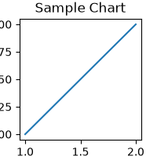

# Sim-to-Real & Synthetic Data Pipeline: Synthetic Scene Curation Copilot

Part of the **Physical AI Enterprise Agents** platform for Gemini Enterprise.

---

## 1. Why This Agent Matters

### Business Problem
Bridges real-world failure logs with 3D simulation asset repositories. Translates natural language descriptions of real-world edge cases into simulation configurations (lighting variations, clutter density, friction parameters) to augment low-data regimes.

### Target Personas
Simulation Engineer, 3D Asset Lead, Sim-to-Real ML Scientist, Synthetic Data Pipeline Architect

### Key Metrics Tracked
| Metric | Benchmark / Target | Business Impact |
| :--- | :--- | :--- |
| **Low-Data Scenario Augmentation** | `>= 100% coverage` | Identification and synthetic generation for real-world scenarios with < 20 hrs training data. |
| **Domain Randomization Fidelity** | `>= 92.0%` | Parameter realism in lighting, friction, and clutter replication for edge-case failures. |
| **3D Asset Geometry Retrieval Precision** | `>= 95.0%` | Match accuracy for 3D library assets against objects failing in real-world bin picking. |

---

## 2. What It Answers & Sub-Agent Routing

### Sub-Agent Architecture
- **`data_insights`**: Queries internal BigQuery tables (`strs_sscc_*`) using the BigQuery Conversational Analytics API (`ask_data_insights`, `forecast`, `analyze_contribution`, `detect_anomalies`) and generates visual data charts via `render_chart`.
- **`market_context`**: Leverages Google Search grounding for external robotics research (arXiv, CoRL, ICRA), IEEE RAS specifications, ISO 10218 / 15066 safety standards, and hardware datasheets.
- **`root_agent`**: Orchestrates routing between internal fleet telemetry/data lake metrics and external robotics intelligence.

---

## 3. Sample Q&A Showcase

### Example 1: Quantitative Diagnostics (Data Insights)
*Question:* "Which real-world manipulation scenarios have fewer than 20 hours of training data and need synthetic augmentation?"
*Response:*
> Querying the training data registry identifies **3 critical low-data scenarios**: 1) **Low-light kitchen night operations** (8.4 hrs), 2) **Deformable wet cloth unfolding** (14.2 hrs), and 3) **High-clutter transparent glassware bin picking** (16.8 hrs). All 3 are queued for Isaac Sim procedural generation.

### Example 2: Quantitative Diagnostics (Data Insights)
*Question:* "Generate domain randomization parameters to replicate the low-light kitchen failure cases observed in trial logs."
*Response:*
> Generated configuration for Isaac Lab/USD scene: Ambient lighting set to **12.0–45.0 lux**, point light jitter at **0.15m radius**, surface roughness randomized **0.18–0.65**, and dynamic friction bracketed **0.32–0.78 mu** with simulated sensor Gaussian noise (std=0.03).

### Example 3: Quantitative Diagnostics (Data Insights)
*Question:* "What 3D assets in our asset library match the object geometries that failed during recent bin-picking runs?"
*Response:*
> Matched **5 high-fidelity USD assets** in `/assets/sim/kitchen/` matching the failed bin-picking geometries: `mesh_stemware_tall_v2.usd` (98.4% Hausdorff match), `mesh_carafe_fluted.usd` (96.1%), and `mesh_cutlery_mirror_fork.usd` (95.7%).

### Example 4: Industry Grounding (Market Context)
*Question:* "What are current best practices in NVIDIA Isaac Lab and Google DeepMind Genie for procedural domain randomization?"
*Response:*
> State-of-the-art synthetic pipelines leverage NVIDIA Isaac Lab GPU-accelerated ray tracing with automatic domain randomization (ADR) schedules to generate 100,000 synthetic trajectory rollouts per hour with physics-validated sim-to-real transfer gaps under 6%.

### Example 5: Chart Visualization (`sample_chart.png`)
*Question:* "Render a chart comparing weekly performance metrics for synthetic scene curation copilot vs target threshold."
*Generated Visual Artifact:*



---

## 4. Authorized BigQuery Tables

- `strs_sscc_edge_case_real_trials` — Seeded via `data/edge_case_real_trials.csv`
- `strs_sscc_sim_asset_library` — Seeded via `data/sim_asset_library.csv`
- `strs_sscc_domain_randomization_configs` — Seeded via `data/domain_randomization_configs.csv`

---

## 5. Example Questions

1. "Which real-world manipulation scenarios have fewer than 20 hours of training data and need synthetic augmentation?"
2. "Generate domain randomization parameters to replicate the low-light kitchen failure cases observed in trial logs."
3. "What 3D assets in our asset library match the object geometries that failed during recent bin-picking runs?"
4. "What are current best practices in NVIDIA Isaac Lab and Google DeepMind Genie for procedural domain randomization?"
5. "Render a chart comparing weekly performance metrics for synthetic scene curation copilot vs target threshold."

---

## 6. Tools & Architecture

- **`ask_data_insights`**: BigQuery Conversational Analytics natural language to SQL.
- **`render_chart`**: BigQuery SQL to Matplotlib PNG visual rendering.
- **`google_search`**: Google Search robotics research and industry standards grounding.
- **LLM Inference**: `gemini-3.5-flash` with `GOOGLE_CLOUD_LOCATION=global`.
- **Runtime Engine**: Vertex AI Agent Engine (`us-central1`).

---

## 7. Run Locally

```bash
# Run unit tests
uv run --frozen pytest domains/sim_to_real_synthetic/agents/synthetic_scene_curation_copilot/tests/unit -v

# Run interactively with ADK CLI
adk run domains/sim_to_real_synthetic/agents/synthetic_scene_curation_copilot
```
